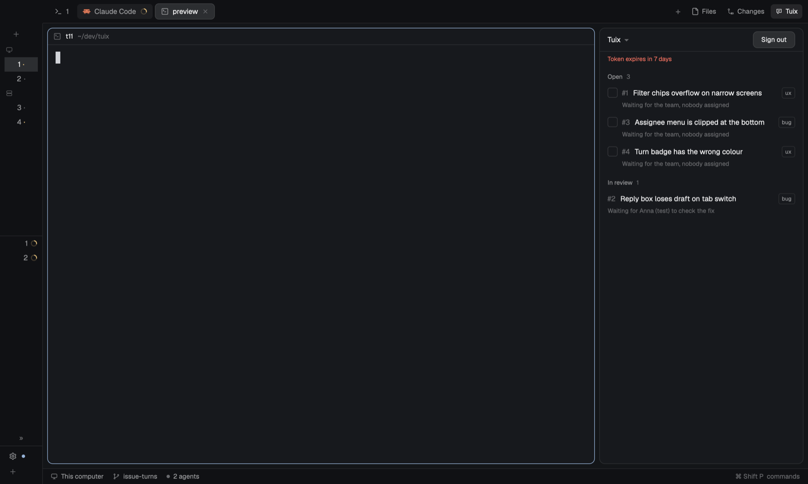

# Tuix

A Herdr layout that is Herdr's own window with one addition: a **Tuix** button in the tab bar that opens a panel on the right showing the issues of your [Tuix](https://tuix.app) project, the one that matches the space you are in. The issues are grouped by what is happening to them, each one says whose turn it is, and you can reply to the reporter, hand an issue to Claude Code to fix in its own worktree, and mark a fixed issue Ready for review. Source: https://github.com/tuix-app/tuix

## What you see

The layout is Herdr's own: a row of a 268px **sidebar** (brand, spaces, agents, footer) and a **work** column (tab bar 42px, the terminals, status bar 28px). The changes are that the tab bar is the `tuix-tabs` mod, and the right-hand **panel** column (368px wide, 280 to 900, hidden until opened) holds a stack of `files`, `changes` and `tuix`.

The tab bar shows the tabs, a `+` button, then **Files**, **Changes** and **Tuix** buttons (14px icon, 12px label, 26px high). **Files** and **Changes** appear only when enabled in `shared("workspace.panels")`; **Tuix** is always shown. The Tuix button reads `Tuix 3` when 3 issues wait for you, `Tuix` when none do. It is highlighted while the Tuix panel is open.

The Tuix panel is a rounded (10px) box with a 1px border, the theme's background, 13px text. Top to bottom:

- A 42px header: the project name (or `All projects`) with a `▾` (click to choose another project), `Archived: read only` for an archived project, `Loading…` while it reads. While signed out it says `Tuix`; while choosing a project, `Choose a project`.
- Notes in 11px text under it, when they apply: the read-only warning (`This connection can read only. Reply and Fix are not available.`), `List cut off — showing the first N.`, and the last error.
- The list, in four groups with a bold 11px header and a count: **Open**, **Being fixed**, **PR open**, **In review**. Only Open is always shown (`Nothing here.` when empty); the others appear when they have issues. Each row: `#number`, the title (one line), a `type` tag, a `severity` tag (`blocking` in red), and below it an 11px turn label.
- **All projects**: the project picker lists it first when the connection reaches more than one project, and the choice is remembered per repository like a project. The list is then one list grouped by status, sorted by project name, and each row shows its project name in 11px text before the turn label. Issues are read per project and status, at most 4 projects at a time, once a minute; an action (reply, Ready for review, a run changing) re-reads only the projects it touched, and moving around inside the same repository re-reads nothing. If a project can't be read the others are still shown, with a note naming it (tried again on the next refresh); a cut-off note names the projects cut. Projects sharing a name show as `name · workspace`. Fix checkboxes appear only on issues of the project matched to the current repository (the project named like it, else the one you last picked for it; remembered under `fixPick`), with the note `Fix works in the matched project's repository.`; Reply, the thread and Ready for review work for any project (an archived project is read only). The tab count is your turn across all of them, using your own id in each project. PR-open runs are retired per project from the lists just read, only for a project read completely.
- Open rows have an 18px checkbox on their left (when the connection can change issues and the project isn't archived). Under a row in Being fixed or PR open: the run line (see below).
- A footer with **Fix N selected** when any Open row is ticked, and the reason when Fix is not possible.

Opening an issue replaces the list with the thread: a 36px bar (`←`, `#number`, severity and type tags), the title, the turn label in a pill and `status · route · environment`, then **Ready for review** and **Fix** when they apply, the screenshot (at most 240px high, the reported element outlined in red, thumbnails when there are several), context chips (the element, the browser, the number of console errors), the comments, and at the bottom a reply box with **Reply** and **Reply & pass ▾**.

## How it behaves

Issue and run states, and how they look:

- Turn labels: `Your turn` (accent color), `Waiting for <name>`, `Waiting for <name> (reporter)`, `Waiting for <name> to check the fix`, `Waiting for the team, nobody assigned`.
- A fix run under a row: **queued**; **working · N min** with a spinning icon (agent working); **needs you · N min** with a dot in the theme's `ansi1` color (agent blocked); **stopped, needs you** in `ansi1` with a **Remove** button (the agent went idle or done after it had been seen working, its terminal was closed, or it failed: `Couldn't start: <reason>`). Before the agent has been seen working, idle or done changes nothing: the row stays "working" until the 2-minute start timeout; for **PR open**, an **Open PR** button (GitHub remote and `gh` signed in) or the branch name, and `stacked on #N` when the agent said so.
- A run counts as stopped if the agent was never seen working or blocked within 2 minutes of starting (`Couldn't start: The agent didn't start.`).
- Agent comments in a thread have a 2px left border in the theme's `done` color, `via <name>`, and an `Open link · <host>` button for each URL (at most 3). Nothing opens until clicked.

Clicks:

- The Tuix tab-bar button opens or closes the panel; the choice is remembered per space.
- The row's text opens the thread; the checkbox only toggles the Fix selection (Open rows, connection that can change issues, project not archived).
- **Fix N selected** (or **Fix** in a thread) queues the issues. At most 3 agents run at once, across all projects and repositories; the rest wait as `queued` and start when a slot frees.
- A run line with a live terminal: clicking it focuses that agent's terminal (`agent.focus`). **Remove** forgets the run; the worktree stays on disk. A **PR open** row has **Remove** too, to clear a finished record by hand; such a record also clears itself once its issue is no longer in progress.
- **Open PR** and `Open link` open the browser only when clicked.
- **Ready for review** is offered in the list on PR open rows (issue in progress with a run whose pull request is open), and in the thread header for any in-progress issue when the connection can change issues and the project isn't archived. It first turns into `Ask <reporter> to check?` with **Cancel** then **Yes**; only **Yes** sets the issue to In review. Nothing else in the panel sets In review. The agent never sets it on its own; it is told to do so only if you tell it to in its terminal, after the fix is deployed.
- **Reply** posts a comment and leaves the turn as it was. **Reply & pass ▾** lists the reporter first (`<name> (reporter)`), then teammates other than you; picking one posts the reply and passes the turn to them. A reply is up to 2000 characters. A failed reply keeps the text and shows the error under the box. A half-written reply is kept as a draft per issue while you leave the thread.
- A screenshot click opens it large in a dialog (outline included); a click closes it. Thumbnails switch the main screenshot. A chip click shows its details as plain text; a second click hides them.

What moves: the panel re-reads the project every 60 seconds and after each action. Agent status changes (working, blocked, idle, done) are picked up as they happen. Runs survive restarting Herdr: they are saved and reattach to their terminals with the elapsed time kept. A folder change inside the same repository and project (a subfolder, a cd, a new space) keeps the open list or thread. When the focused folder changes to another repository, the panel finds that repository's project; a repository with no project of the same name asks you to pick one, and remembers the choice per repository. The Fix selection stays through folder changes inside the same repository and project. A session Tuix ends (the refresh fails) sends the panel back to sign-in with `Your Tuix session ended. Sign in again.`

Signing in: the panel asks for the Tuix address (default `https://tuix.app`): a bare origin with no path, query, hash or credentials, `https`, or `http` only for `localhost` and `127.0.0.1`, and a **Sign in with Tuix** button. It reads Tuix's OAuth metadata (`/.well-known/oauth-authorization-server`), registers itself once per address as the client "Herdr" (the public client id is kept in view-local storage under `clients`), asks for a device code and shows the user code large with `Opening your browser… Approve the code there.`, **Open browser** and **Cancel**. The browser opens once by itself (`cx.open_url`), then the panel polls on a `cx.timer` at the server's interval (5 seconds slower after `slow_down`). Declined: `Sign-in was declined.`; expired: `The code expired. Try again.`; a server without device sign-in: `This Tuix doesn't support sign-in from Herdr yet.` On approval the access and refresh tokens stay in memory only; the access token is refreshed about 5 minutes before it expires, and after a 401 the call is retried once after a refresh. A refresh Tuix refuses shows `Your Tuix session ended. Sign in again.` A saved address is only filled in at start: the panel never opens the browser by itself. The view also says that agents use their own Tuix connector in Claude Code, which must be allowed to change issues. Once connected, a **Sign out** button in the header of the project picker and the list returns to sign-in with the address kept in the field: it drops the in-memory session (and asks Tuix to revoke the refresh token when the metadata has a revocation endpoint), clears the list, selection and open thread (saving any draft), and leaves the runs alone.

## Built from

Layout `layouts/tuix.json`: Herdr's shipped `main` layout copied, with the `tabs` block's mod changed to `tuix-tabs` and a `tuix` block (mod `tuix`) appended to `panel-body`. Its nodes: `root` (row) containing `sidebar` (column, 268px: `brand` 46px using `workspace-chrome`, `sidebar-lists` with `spaces` and `agents`, `sidebar-footer` 69px using `workspace-chrome` with `props.footer`) and `work` (column: `tabs` 42px using `tuix-tabs`, `work-body` row with `main` (the active tab, bordered, rounded 10) and `panel` (column, hidden, 368px, min 280, max 900, containing the stack `panel-body` with `files`, `changes` and `tuix` blocks), `status` 28px using `workspace-status`). The shipped mods it uses besides these are `workspace-chrome`, `spaces`, `agents`, `pane`, `files`, `changes`, `workspace-status`, plus `menu` and `new-menu` overlays opened by the tabs.

Mod `mods/tuix` (`mod.json`: `{ "place": "none", "title": "Tuix" }`), one view in `main.js` with `list.js`, `thread.js`, `signin.js`, `launch.js`, `shots.js` and plain helper modules in `lib/` (`mcp.js` the Tuix MCP client, `oauth.js` the OAuth device flow, `session.js` the in-memory session with refresh, `issues.js` grouping and turn labels, `rows.js`, `thread.js`, `runs.js`, `launch.js`, `git.js`, `prompt.js`), art `tuix.svg` (a speech bubble, 24px viewBox). It opens screenshots in a dialog by opening itself with `props.shot`.

Mod `mods/tuix-tabs` (`{ "place": "none", "title": "Tuix tabs" }`): Herdr's shipped `tabs` mod cloned (`mod.clone`) with three changes: `"tuix"` appended to the enabled panels, a Tuix `panelButton` reading `shared("tuix.count")`, and the `mods/tabs/win-*.svg` art paths rewritten to `mods/tuix-tabs/` (plus the `mod.json` title). It is the tab bar (tabs with drag-to-reorder, double-click rename, right-click menu, a `+` menu, Files/Changes/Tuix panel buttons, window buttons with `win-*.svg` art on Windows). The Tuix button selects the `tuix` child of `panel-body` and shows the `panel` node. It reads `shared("tuix.count")`, which the `tuix` mod sets with `setShared` to the number of issues whose turn is yours (or the team's when your identity is unknown).

`herdr` functions the mods call: `spaces`, `panes`, `focused`, `terminals`, `agents`, `exec`, `theme`, `settings`, `setShared`, `shared`, `props`, `openOverlay`, `closeOverlay`, `run`, `home`, `appHome`, `window`, `layout`. Commands: `agent.focus`, `layout.select`, `layout.show`, `layout.hide`, `tab.select`, `tab.move`, `tab.rename`, `tab.close`, `tab.prev`, `tab.next`, `window.minimize`, `window.maximize`, `window.close`. View-local storage holds the Tuix address, the public client id per address, the chosen project per repository and the fix runs, never a token.

Tuix MCP tools called on `<address>/mcp` (JSON-RPC, bearer access token): `list_projects`, `list_issues` (one status at a time: open, in_progress, in_review), `get_issue`, `list_people`, `reply_to_issue`, `set_issue_status`. Lists follow cursors up to 20 pages.

Programs run (through `exec`, never a shell, arguments always an array):
- `git`: `rev-parse`, `symbolic-ref refs/remotes/origin/HEAD`, `fetch origin`, `show-ref`, `worktree list` and `worktree add` (branch `tuix-<number>-<slug>` off the remote's default branch, at `~/.herdr/worktrees/<repo>/<branch>`), `remote get-url origin`.
- `gh pr view <branch> --json url` to find the pull request, only when the remote is on github.com.
- `curl -sSf --max-time 20` to download a screenshot, then `mv` to put it in place.
- `herdr-app do space.new` with `{folder, argv: ["claude", "--permission-mode", "auto"], task}` to open a space for each fix.
- `claude` itself, started by Herdr in that space. Its first message tells it to read the issue with the Tuix MCP, claim it (`in_progress`), fix it on the branch with tests, open a pull request (GitHub with `gh`) or push the branch, reply on the issue without passing the turn, never set In review, never close or reassign. The message holds no token.

Borrowed art: `mods/workspace-chrome/spinner.svg`, `mods/pane/close.svg`, `mods/files/file.svg`, `mods/changes/changes.svg`; own art `mods/tuix/tuix.svg`, `mods/tuix-tabs/win-*.svg`. File calls (`fs/promises`): `mkdir`, `readdir`, `unlink`, `access`/`exists`.

Files written: `mods/tuix/.cache/<issue>-<screenshot>.png` (hidden folder, so writing does not reload the mod; removed for issues no longer listed), and git worktrees.

## Watch out

- It reaches the network: the Tuix address you enter (and, for screenshots, the signed URLs Tuix returns, via `curl`).
- It runs programs: `git`, `gh`, `curl`, `herdr-app`, `claude`, `mv`.
- It writes `mods/tuix/.cache` and, per fix, a git worktree and branch under `~/.herdr/worktrees/<repo>/<branch>`. A removed run leaves its worktree on disk; fixing the same issue again reuses it.
- It starts autonomous coding agents (`claude --permission-mode auto`) that change code, push, and open pull requests. At most 3 run at once, in total.
- The new space is left unnamed; worktree spaces show nested under the repository's space in the sidebar because Herdr's `spaces` mod nests by git worktree linkage, not by name.
- `main` and `tabs` are shipped and read-only, so they are cloned (`tuix-tabs`, `layouts/tuix.json`), never edited.
- Fixes run on this computer only for now. In a space on another machine, Fix is disabled (`Fixes run on this computer only for now.`).
- Needs a Tuix server whose MCP has `reply_to_issue`; a connection without it can list and open issues but not Reply, Fix or Ready for review (`This connection can read only…`). Agents need the Tuix connector in Claude Code, allowed to change issues; if not, the agent stops with "My Tuix connection can't change issues."
- Fix needs a git repository with an `origin` remote and an `origin/HEAD`; otherwise it is disabled with `Fix needs a git repository with an origin remote.`
- Tokens (access, refresh) and the device code must never be stored: they live in memory only, so the person approves again after Herdr restarts. They are never written to `localStorage`, shared state, a file, a log, an argument, or the agent's environment or message. Only the address and the public client id are stored.
- Limits: lists stop after 20 pages with `List cut off — showing the first N.`; a thread shows comments from at most 20 pages and says `Newer comments are not shown here. Open the issue in Tuix.` beyond that; a run that never shows the agent working within 2 minutes is stopped; polling is every 60 seconds, and runs are tracked only while the panel is on the list or an open thread. A screenshot link is valid for about 5 minutes; a failed download re-reads the issue once for a fresh one.
- Report text (titles, comments, screenshots, console lines) comes from people using the reported app: it is shown as plain text only, and links open only on a click.
- In review is set only by the person's **Ready for review** then **Yes**. An agent does it only if the person tells it to in its terminal.
- Controls that do nothing: none. Tuix sets no keys (no `keys.json`).

## Done when

- `herdr-app check mods/tuix` and `herdr-app check mods/tuix-tabs` pass, and after `layout.switch {"name":"tuix"}` the tab bar shows a **Tuix** button that opens the panel on the right.
- Signed in, in a space whose repository has a project of the same name, the list shows that project's issues in Open, Being fixed, PR open and In review, with turn labels, and the tab button shows the number of issues waiting for you.
- Signing in opens the browser once with a code; approving there connects the panel. Revoking "Herdr" in Tuix's connected apps sends the panel back to sign-in with "Your Tuix session ended. Sign in again." within a minute. Restarting Herdr shows the sign-in view without opening the browser. Searching Herdr's data and `shared.json` for a token finds nothing.
- Opening an issue shows the thread with the screenshot and outlined element, chips, and comments; the checkbox does not open it; a failed load shows "Couldn't load this issue" with **Retry**; a screenshot cached under `mods/tuix/.cache` still loads after its link expires.
- **Reply** posts and keeps the turn; **Reply & pass ▾** lists the reporter then teammates and the turn label updates; a refused reply keeps the text with the error; the draft returns after leaving and reopening the thread.
- Agent comments show the `done`-colored left border, `via <name>`, and link buttons that open nothing until clicked.
- **Ready for review** asks first with Cancel then Yes; Yes moves the issue to In review; nothing else does.
- Selecting two issues and **Fix 2 selected** opens two unnamed spaces nested under the repository in `~/.herdr/worktrees/<repo>/tuix-<number>-<slug>`, each running `claude --permission-mode auto`, the rows move to Being fixed with spinners, and clicking a run line focuses its terminal. The agent's environment holds no token.
- When an agent replies on the issue, its row moves to PR open with **Open PR** or the branch name.
- Four selected issues run three and queue one; the limit holds across repositories; restarting Herdr keeps the runs attached with their elapsed time.
- Closing an agent's terminal, or exiting `claude`, turns the row "stopped, needs you" with **Remove** and frees its slot; **Remove** keeps the worktree; fixing again reuses it. A start failure shows `Couldn't start: <reason>`. With a read-only connection, an archived project, another machine or no `origin`, Fix is disabled with the reason.
